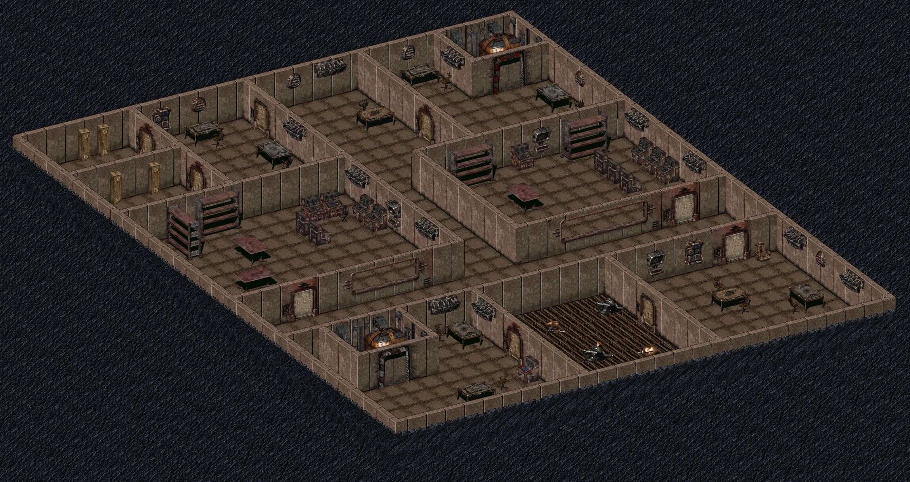
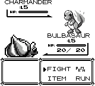
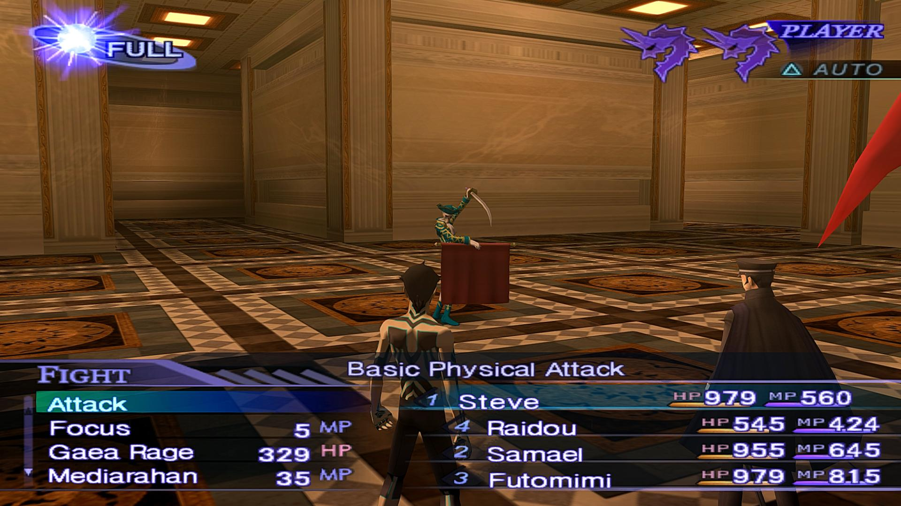
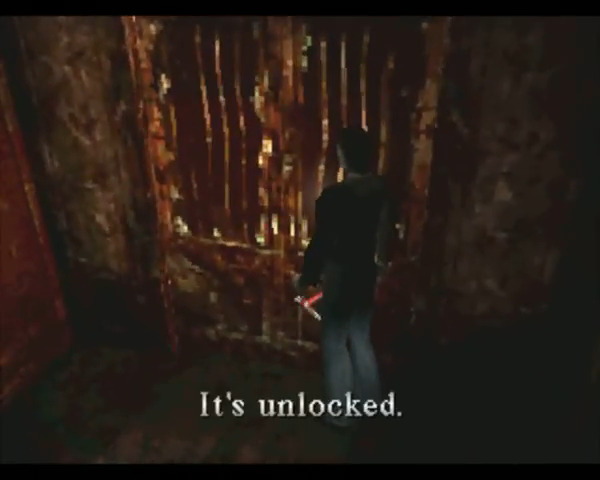
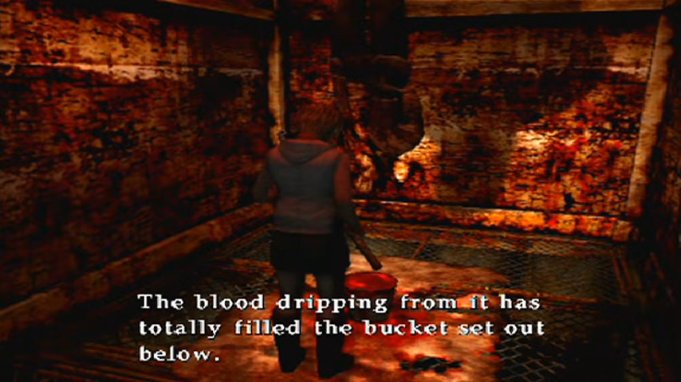

# Общая информация

## Краткое описание игры

Pinocchio 31.04834939252005 - однопользовательская top-down JRPG в стиле ранних Pokemon. Игрок исследует многоуровневую шахту, расположенную в постапокалиптическом мире, сражается с противниками, решает головоломки и постепенно приближается к своей цели - комнате, исполняющей желания.

## Жанр и целевая аудитория

- Жанр: ролевая игра
- Целевая аудитория: 16+
- Настроение: депрессивный и тяжелый опыт
- Сеттинг: постапокалипсис, далекое будущее
- Тема:
- Технология: Construct 3

## Основные особенности игры

# Управление

## Управление клавиатурой

| Клавиша | Действие               |
|---------|------------------------|
| ↑/w     | Движение вверх         |
| ↓/s     | Движение вниз          |
| →/d     | Движение вправо        |
| ←/a     | Движение влево         |
| E       | Взаимодействие         |
| Enter   | Подтвердить действие   |
| Esc     | Выход / закрыть промпт |

## Управление в бою

| Клавиша | Действие               |
|---------|------------------------|
| ↑/↓/→/← | Выбор действия         |
| w/a/s/d | Выбор действия         |
| Enter   | Подтвердить выбор      |

# Основные игровые системы

## Перемещение

- Игрок может перемещаться в четырёх направлениях
- Перемещение происходит по квадратной сетке
- Некоторые объекты окружения могут препятствовать движению

## Камера

### Камера во время исследования

- Вид сверху (top-down)
- Камера следует за главным героем
- Герой расположен в центре экрана
- Камера не вращается
- При достижении границ локации камера ограничивает своё перемещение

### Камера во время боя

- Бой происходит на отдельном экране
- Камера неподвижна
- Союзники и противники располагаются на заранее определённых позициях

### Камера в других игровых ситуациях

- На самом первом уровне (пропасть) камера зафиксирована и отдалена
- Диалоги и промпты отображаются в нижней части экрана

## Взаимодействие

- Игрок может взаимодействовать с некоторыми объектами при приближении к ним
- Взаимодействие осуществляется отдельной кнопкой
- Объекты могут содержать информацию, активировать механизмы, хранить предметы

## Исследование

- Игрок исследует комнаты и коридоры
- На уровнях находятся противники, интерактивные объекты и головоломки
- Для перехода на следующий уровень нужно найти и активировать лифт

## Диалоги и промпты

В текстовых окнах игрок может общаться с союзниками (вне боя), выбирать действия (взаимодействуя с предметами).

Примеры действий:

- Нажать на кнопку
- Открыть дверь

# Боевая система

## Основные правила

- У каждого участника сражения есть определённое количество HP (очков здоровья) и SP (очков энергии). Очки можно тратить на действия в бою. Некоторые действия (ожидание, физическая атака, использование предмета) не расходуют очки.
- Персонаж умирает, если его HP падает до нуля.
- Если все подконтрольные игроку персонажи умирают, игра заканчивается.
- В бою можно использовать предметы (аптечки, расходники).

## Press Turn

Боевая система использует механику Press Turn из Shin Megami Tensei:

- Боевая система пошаговая. Сначала ходит партия игрока, затем противники
- В начале хода сторона получает определённое количество иконок действий (Press Turn Icons)
- Количество иконок зависит от размера партии игрока (т.е. партия из трёх членов получает три иконки). В случае смерти одного из членов партии количество иконок уменьшается соответственно
- Обычное действие (или использование предмета) расходует одну полную иконку
- Успешное действие (попадание по уязвимости или критический удар) расходует половину иконки
- Неудачное действие (промах или попадание по блокируемому типу урона) расходует дополнительную иконку
- После использования всех иконок ход переходит к противоположной стороне
- Правила применяются как к союзникам, так и к противникам

## Типы урона

Атаки могут наносить разный урон.

| Тип урона | Описание                                       |
|-----------|------------------------------------------------|
| Cut       | Рубящие физические атаки                       |
| Pierce    | Колющие физические атаки                       |
| Blunt     | Дробящие физические атаки                      |
| Holy      | Атаки, использующие святую энергию             |
| Occult    | Атаки, использующие оккультную энергию         |

## Уязвимости и сопротивления

Каждый противник обладает уязвимостями и сопротивлениями к различным типам урона.

| Состояние     | Эффект                                                                  |
|---------------|-------------------------------------------------------------------------|
| Vulnerability | Повышенный получаемый урон, дополнительная иконка Press Turn атакующему |
| Normal        | Обычный получаемый урон                                                 |
| Resist        | Пониженный получаемый урон                                              |
| Null          | Невосприимчивость к типу урона, потеря атакующим иконки Press Turn      |
| Repel         | Отражение атаки обратно атакующему, потеря атакующим иконки Press Turn  |

## Баффы и дебаффы

Баффы и дебаффы (далее - БД) - это эффекты, временно меняющие характеристики персонажа (могут влиять как положительно, так и отрицательно).

Примеры БД:

| Название | Эффект                     |
|----------|----------------------------|
| Staccato | Увеличивает наносимый урон |
| Fermata  | Уменьшает получаемый урон  |

Отдельный вид БД - снятие или наложение сопротивлений к определенным видам урона. Примеры:

| Название     | Эффект                         |
|--------------|--------------------------------|
| Holy Wall    | Дает сопротивление к Holy      |
| Occult Break | Снимает сопротивление к Occult |

## Статус-эффекты

Как и баффы/дебаффы, статус-эффекты могут кардинально поменять обстановку на поле боя. Они влияют на способность персонажа участвовать в сражении.

Статус-эффекты действуют определённое количество ходов. Использование лечебных заклинаний или предметов позволяет снять с персонажа статус-эффект.

Примеры статус-эффектов:

| Название  | Эффект                                           |
|-----------|--------------------------------------------------|
| Bleed     | Персонаж получает урон после каждого хода        |
| Brainwash | Персонаж оборачивается против своей партии       |
| Stun     | Персонаж временно теряет способность действовать |

# Союзники и партия игрока

- Спутники находятся в начале уровня и не следуют за игроком
- В бою игрок управляет действиями союзников. Они не имеют собственного ИИ

# Противники

Противники делятся на обычных врагов и боссов. Обычные враги встречаются на карте, тогда как боссов можно встретить только в конце уровня.

# Дополнительные системы

## Карта

Карта отображает исследованные помещения.

# Игровой цикл

## Основной игровой цикл

Основной игровой цикл состоит из четырёх этапов:

### Исследование

Игрок перемещается по локации, ищет объекты, изучает окружение.

### Взаимодействие

Игрок решает головоломки, активирует механизмы, взаимодействует с объектами.

### Сражение

Игрок сражается с противниками, использует навыки, эксплуатирует уязвимости противников.

### Продвижение

Игрок ищет лифт, активирует его, переходит на следующий уровень.

## Метацикл

1. Исследование поверхности
2. Спуск в шахту
3. Последовательное прохождение уровней
4. Достижение дна и комнаты исполнения желаний

# Сюжет

## Синопсис

Конец 21-го века. Земля опустошена после термоядерной войны. Большую часть суши занимает мертвая пустыня. Воздухом трудно дышать из-за сильного загрязнения. Магнитное поле почти исчезло, солнечные ветры вызывает северные сияния по всему миру. Из-за этого электроника еле работает. То тут, то там на земле лежат упавшие с неба спутники и прочий космический мусор, не сгоревший в атмосфере. Время от времени на пустоши крепчает ветер, вызывающий свирепые песчаные бури.

После войны людей на планете осталось всего несколько тысяч, а может, даже сотен. Война и её последствия - сильный радиационный фон, массовая миграция, голод - практически стёрли человечество с лица Земли. Это конец всему. Или нет?

Цель игры - найти вход в Ад. Он явился в виде бездонной, невероятно глубокой дыры, дна которой не видно.

На дне этой дыры находится комната, исполняющая желания.

## Протагонист

Киборг, странствующий по Земле с двумя спутниками. Ему кажется, что когда-то давно он был человеком, но он в этом не уверен. На его металлическом каркасе держатся остатки плоти, но она уже начала гнить и отваливаться. Он не помнит, что именно находится у него в голове: человеческий мозг или процессор.

Киборг не помнит, есть ли у него имя.

Мотивация у протагониста следующая: он услышал слухи о входе в ад и ему стало любопытно. Так любопытно что он решил отправиться самолично узнать что находится в дыре.
О исполнителе желаний протагонист узнаёт только в середине сюжета.

## Союзники

У главного героя два союзника: Он и Она. Главный герой не знает (или не помнит) их имён.

# Локация

Шахта состоит из трех уровней. На каждом уровне нужно попасть к лифту, чтобы спуститься ниже.

## Уровень 0: поверхность, 0 км

Обучающий, содержит один предмет для исследования и пропасть (вход на первый уровень).

## Уровень 1: Ieiunum, 914 км

Первый уровень. Содержит первого сюжетного босса.

## Уровень 2: Colon sigmoideum, 5993 км

Второй уровень. Содержит второго сюжетного босса.

## Уровень 3: Нигде, ????? км

Последний уровень. Содержит финального босса и комнату исполнения желаний.

# Референсы

\newpage

\newpage

\newpage

\newpage

\newpage

# Тезаурус

1. Press Turn - пошаговая боевая система, в которой количество доступных действий определяется специальными иконками. Эффективное использование атак позволяет экономить иконки, а неудачные действия приводят к их дополнительной потере.
2. Press Turn Icon - единица действия в боевой системе. Используется для выполнения атак, применения навыков и других действий.
3. Критический удар - атака, наносящая повышенный урон и предоставляющий атакующему преимущество.
4. Статус-эффект - временное состояние персонажа, ограничивающее его возможности или оказывающее дополнительное воздействие на ход сражения.
5. Бафф (buff) - временный положительный эффект, изменяющий характеристики персонажа или предоставляющий ему дополнительные преимущества.
6. Дебафф (debuff) - временный отрицательный эффект, ухудшающий характеристики персонажа или ограничивающий его возможности.
7. Навык (skill) - особое действие, доступное персонажу в бою и обладающее определённым эффектом.
8. Null - свойство персонажа, полностью предотвращающее получение урона определённого типа.
9. Repel - свойство персонажа, отражающее получаемую атаку обратно атакующему.
